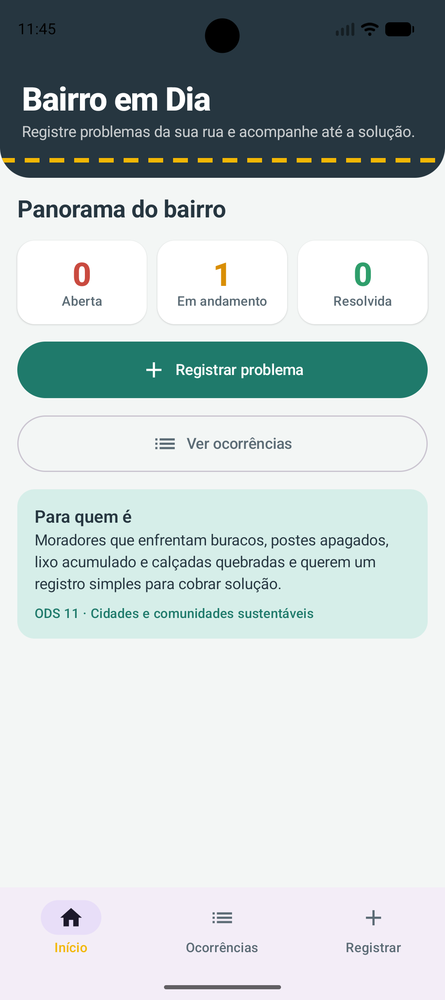
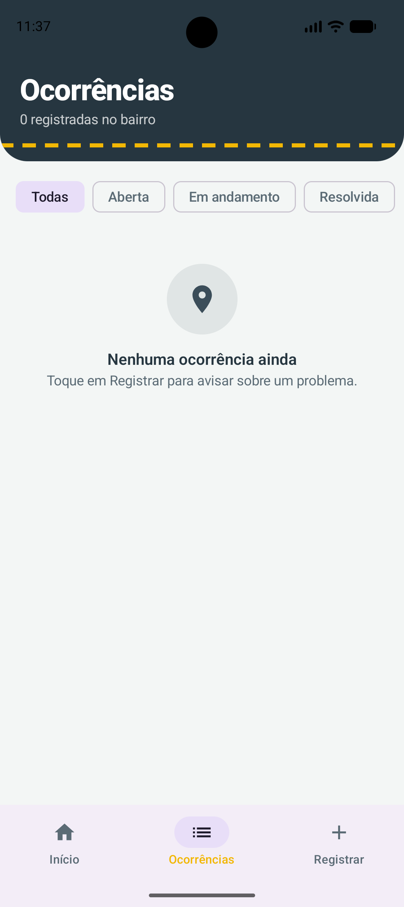
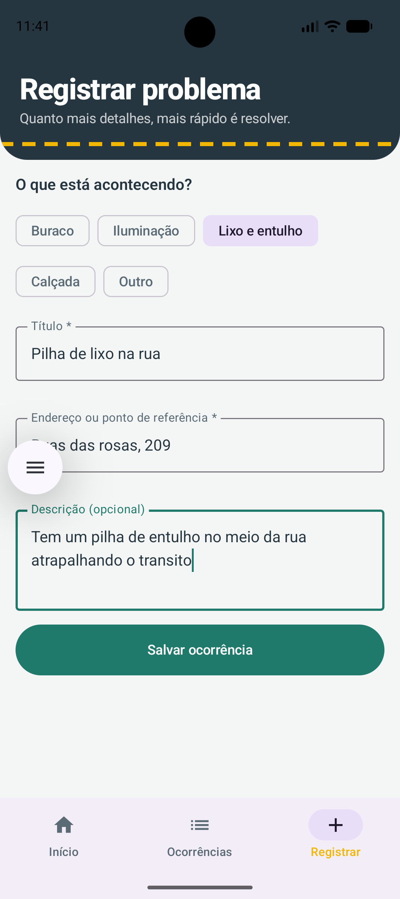
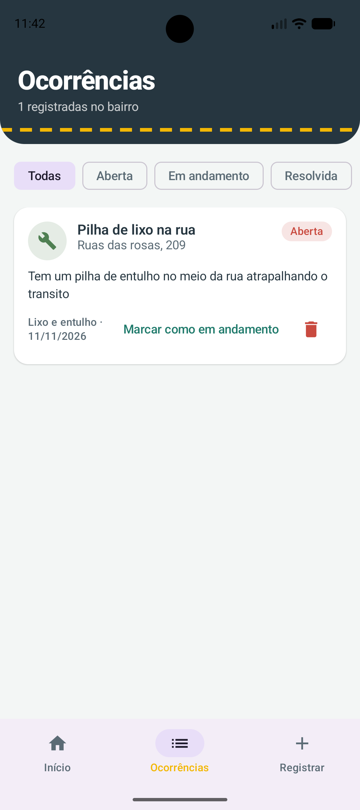
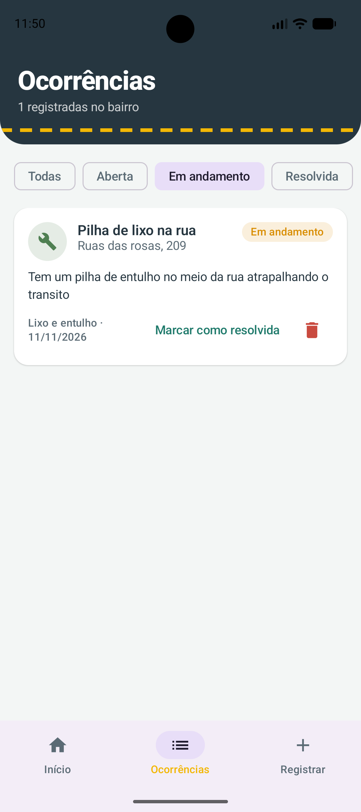

# Bairro em Dia

Aplicativo Android para registrar e acompanhar problemas de zeladoria urbana, como buracos, iluminação pública, lixo acumulado e calçadas quebradas.

Projeto da **Global Solution 2026.2 · Android Kotlin Developer** (FIAP), dentro do desafio **CitizenTech**.

## Integrantes

| Nome completo | RM |
|---|---|
| Davi Queiroz Santos | 557483 |
| Eduardo Augusto Risch | 555212 |

## Problema

Buracos, postes apagados, lixo acumulado e calçadas quebradas afetam a segurança e a mobilidade de quem vive no bairro. Muitas vezes o morador não sabe como avisar, não tem um registro do que já foi reportado e não consegue acompanhar se o problema foi resolvido.

## Público beneficiado

Moradores de bairros urbanos que convivem com problemas nos espaços públicos. O app também ajuda quem mais sofre com calçadas e vias mal conservadas, como idosos, cadeirantes e pessoas com mobilidade reduzida.

## Proposta

Um aplicativo simples para o morador:

1. **Registrar** o problema, com categoria, título, endereço e descrição.
2. **Acompanhar** cada ocorrência por status: Aberta, Em andamento e Resolvida.
3. **Visualizar** um panorama do bairro, com a quantidade de ocorrências em cada status.

Este é um protótipo acadêmico. Ele não está integrado a serviços da prefeitura nem a dados em tempo real.

## ODS relacionados

**ODS 11: Cidades e comunidades sustentáveis.** O app contribui para tornar os espaços urbanos mais seguros, acessíveis e bem conservados (meta 11.2, acesso a sistemas de mobilidade seguros e acessíveis, e meta 11.7, acesso a espaços públicos seguros e inclusivos). Ao organizar o registro e o acompanhamento dos problemas, ele facilita a participação do cidadão na manutenção da cidade.

## Funcionalidades

- Tela inicial com identidade visual, resumo por status e acesso às demais telas.
- Cadastro de ocorrência com validação: título com pelo menos 3 caracteres e endereço obrigatório.
- Listagem em cards com filtro por status.
- Alteração de status (Aberta, Em andamento, Resolvida) e exclusão com confirmação.
- Mensagens de confirmação (Snackbar) e estado vazio quando não há registros.
- Persistência local com Room: os registros continuam disponíveis após fechar e reabrir o app.

## Tecnologias

| Tecnologia | Uso |
|---|---|
| Kotlin 2.2.10 | Linguagem |
| Jetpack Compose + Material 3 | Interface |
| Navigation Compose | Navegação entre telas |
| ViewModel + StateFlow | Estado e lógica de apresentação |
| Room 2.8.4 + KSP | Persistência local |
| Android Gradle Plugin 9.2.1 | Build |

## Estrutura do projeto

```
app/src/main/java/davi/github/com/conectapovokt/
├── MainActivity.kt
├── model/        Ocorrencia (entidade), Categoria, Status
├── data/         AppDatabase, OcorrenciaDao, OcorrenciaRepository
└── ui/
    ├── OcorrenciaViewModel.kt
    ├── navigation/   AppNavigation
    ├── screens/      Início, Lista, Cadastro e componentes
    └── theme/        Cores, tipografia e tema
```

## Como executar

Requisitos: Android Studio recente, JDK 21 (o JDK embutido do Android Studio serve) e um emulador ou dispositivo com Android 7.0 (API 24) ou superior.

1. Extraia o projeto e abra a pasta no Android Studio (**File > Open**).
2. Aguarde o **Gradle Sync** terminar.
3. Selecione um emulador ou dispositivo.
4. Clique em **Run**.

## Fluxo principal e evidências

O fluxo principal é: **registrar um problema, acompanhar na lista e atualizar o status**.

### 1. Lista vazia (estado inicial)



### 2. Lista vazia (estado inicial)



### 3. Validação do formulário



### 4. Criação de um registro



### 5. Ação adicional: alteração de status


### 6. Persistência após fechar e reabrir o app


